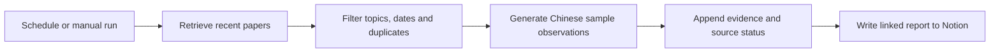

# notion-monthly-research

English | [简体中文](README.zh-CN.md)

**Turn research topics into a traceable reading list in Notion.**


A personal research tool for people who organize papers in Notion. Track recent arXiv papers and records from selected venues, generate short observations, and archive paper titles, dates, matched keywords, abstract excerpts, and source links. Run it monthly with GitHub Actions or trigger it manually.

**The generated report currently uses Chinese headings and Chinese model observations.** Paper titles and abstract excerpts retain their source language. This English README does not change the report language.

[Real retrieval example](examples/source-preview.en.md) · [Quick start](#quick-start) · [Preview locally](#local-use-and-previews) · [Troubleshooting](#troubleshooting) · [Usage and licensing](#usage-and-licensing)

## What it does

- **Automates recurring collection:** retrieves, filters, and appends results to a Notion page you authorize.
- **Keeps the evidence:** clickable paper titles, dates, and abstract excerpts remain alongside the model's observations.
- **Lets you choose a provider:** DeepSeek by default, with optional OrcaRouter support and your own API keys.
- **Supports previews:** inspect retrieved papers without a model, generate local Markdown, or test delivery in a separate Notion child page.

Designed for researchers with specific topics who are comfortable configuring GitHub Actions and a Notion integration. This is a self-deployed tool, not a hosted subscription or an exhaustive systematic-review search service.

## Quick start

You need a GitHub account, a Notion page you can connect to an integration, and an API key for your selected model provider. Read [usage and licensing](#usage-and-licensing) before relying on permissions for your intended use.

1. Fork the repository, open **Actions**, and enable workflows.
2. Create an integration in [Notion My Integrations](https://www.notion.com/my-integrations) and save its token. On your target page, open **••• → Add connections** and connect the integration. Copy the page ID: the 32-character ID from the URL, not the entire URL. A hyphenated UUID is also accepted.
3. Open **Settings → Secrets and variables → Actions → Secrets** in your repository and add these three secrets:

| Secret | Default: DeepSeek | With OrcaRouter |
| --- | --- | --- |
| Model API key | `DEEPSEEK_API_KEY` | `ORCAROUTER_API_KEY` |
| Notion integration token | `NOTION_TOKEN` | `NOTION_TOKEN` |
| Target page ID | `NOTION_PAGE_ID` | `NOTION_PAGE_ID` |

4. Under **Variables**, set `QUERY_KEYWORDS`, for example `multimodal alignment, contrastive learning`. For OrcaRouter, also set `LLM_PROVIDER=orcarouter`. Otherwise, DeepSeek is used.
5. Open **Actions → Monthly Notion Summary → Run workflow**. For your first run, select `test_page` to create a separate child page under the configured target. Keep `provider=configured` to use repository settings, or choose a provider for this run.
6. After completion, check the Notion report: sample observations, the paper lists, and source-status notes. Test mode also verifies the report sections and clickable paper titles. Subsequent runs without `test_page` append directly to your target page.

The scheduled run is on the **first day of each month at 00:00 UTC / 08:00 China Standard Time**. Reruns append again; there is no replacement or deduplication across separate runs. After a partial write failure, inspect the page before rerunning.

## Providers and costs

The default connects directly to [DeepSeek](https://platform.deepseek.com/) using `deepseek-reasoner`. The OrcaRouter preset uses `deepseek/deepseek-v4-flash-free` at `https://api.orcarouter.ai/v1`. Model availability, quotas, and prices depend on the provider's current catalog. Free availability is not guaranteed permanently.

Existing OrcaRouter users can use their own keys. New users may register through the [project referral link](https://www.orcarouter.ai/ref/ref_cb687af623af382d6377). **Referral disclosure:** eligible paid usage attributed under the platform's rules may generate a commission for the maintainer. The link and the provider are optional.

The partner integration guide describes referral-link attribution for new signups. An existing account using its own API key is not automatically attributed to the maintainer just because it runs this tool. This project does not currently implement authenticated application-based login attribution.

Model calls, GitHub Actions, and other services may incur their own charges. Check your account quotas. The script does not purchase subscriptions or top up accounts.

## Configuration

| Setting | Location in GitHub Actions | Purpose |
| --- | --- | --- |
| `LLM_PROVIDER` | Variable | `deepseek` (default) or `orcarouter` |
| `QUERY_KEYWORDS` | Variable | Comma-separated topic phrases; the legacy Secret of the same name is also supported, with the Variable taking precedence |
| `CCF_A_VENUES` | Variable | Optional comma-separated venue list; defaults to the list in the script |
| `SEMANTIC_SCHOLAR_API_KEY` | Secret | Optional API key for Semantic Scholar requests |

A paper must match at least one complete keyword phrase in its title or abstract. Matching ignores case and hyphen differences, with word boundaries: `CT` does not match `activity`. Broad topics can still produce papers outside your intended scope. Add synonyms and abbreviations yourself; this is not semantic search.

`CCF_A_VENUES` is a legacy configuration name. The configured list and Semantic Scholar's index determine the venues searched. The tool does not certify their current CCF ranking or cover every venue.

## Local use and previews

Requires Python 3.10+. Create an isolated environment in the repository directory:

```bash
python3 -m venv .venv
source .venv/bin/activate
python -m pip install -r requirements.txt
```

**Retrieve papers only, without model or Notion credentials:**

```bash
QUERY_KEYWORDS="multimodal alignment" python push_summary.py --fetch-only --output papers.md
```

**Generate a local report without writing to Notion:** securely provide `OPENAI_API_KEY` as an environment variable, then run:

```bash
python push_summary.py --dry-run --output report.md
```

**Publish to Notion:** additionally provide `NOTION_TOKEN` and `PAGE_ID`, then run:

```bash
python push_summary.py
```

For local OrcaRouter use, set `OPENAI_BASE_URL=https://api.orcarouter.ai/v1` and `OPENAI_MODEL=deepseek/deepseek-v4-flash-free`, and supply your OrcaRouter key through `OPENAI_API_KEY`.

The script does not automatically load `.env`. Inject credentials through your process environment or your own secret-management tool. Do not put real keys in source files, public issues, or screenshots. `--dry-run` still calls the model and may incur charges; only `--fetch-only` skips the model.

## How it works and its limits



[Workflow](.github/workflows/main.yml) · [Script](push_summary.py) · [Editable diagram, Chinese](assets/readme/workflow-zh.drawio)

| Stage | Behavior |
| --- | --- |
| arXiv | Retrieves recent candidates and checks topic, date, and duplicates locally; retains up to 12 papers. If the API is unavailable, tries one public search page and filters its first 50 candidates, noting the coverage limit |
| Semantic Scholar | Makes one bulk request with topic, venue, and date filters; retains up to 3 papers per venue and 12 in total, without following later result pages |
| Model | Generates 2–4 Chinese observations from titles and abstract excerpts; the program appends paper records and source-status notes independently |
| Notion | Converts headings, paragraphs, and lists into blocks; preserves paper links and appends in batches |

This is not full-text verification. Abstract excerpts are limited to 1,500 characters per paper. Model observations may be wrong; read the original paper before citing a research conclusion. If neither source supplies valid paper records, generation stops. An unavailable individual source is explicitly reported.

Your model provider receives the query topics and selected paper titles and abstract excerpts. The script does not read existing Notion page content for generation. Reports are written to the page you authorize. No maintainer-operated user-tracking service has been added; each external platform's data policies still apply.

## Troubleshooting

| Symptom | What to check |
| --- | --- |
| `Missing required configuration` | Check the selected provider's API Secret, `NOTION_TOKEN`, and `NOTION_PAGE_ID`. Do not store credentials as Variables |
| Notion 401 / 403 / 404 | Check the token, page ID, and whether the integration is connected to that page |
| Model authentication, quota, or missing-model error | Check the provider's key, account quota, and current model catalog; keys from different platforms are not interchangeable |
| Rate-limited sources or empty venue results | Read the source-status notes; try later or revise the keywords. Empty results do not prove there are no relevant papers |
| `No paper records retrieved` | Neither source supplied valid records; the model was not asked to generate a report |
| Some blocks appeared before a failure | Inspect existing content before rerunning to avoid duplicates. Ambiguous Notion write failures are not blindly retried |
| Scheduled runs missing after a fork | Enable Actions and run the workflow manually first; check GitHub's current restrictions on scheduled workflows |

## Feedback

Open an [issue](https://github.com/Xiaoqian-Zhang-Shawno/notion-monthly-research/issues) with your run mode, error type, and expected versus actual behavior. Remove API keys, private Notion page IDs, confidential research topics, and personal information from logs before sharing them.

## Usage and licensing

This is an independently maintained repository with publicly visible source code. It is **not currently licensed under MIT or another standard open-source license**. See [COPYRIGHT.md](COPYRIGHT.md) for the current rights notice. Commercial integration, resale, hosting, and white-label use require checking the applicable permissions with the maintainer.

A complete end-user license is still being finalized. This notice does not revoke existing valid rights or replace the licenses of third-party components. Public visibility and a working referral link do not establish unrestricted commercial permission or platform acceptance of a future license.

<details>
<summary>Early project history</summary>

- June 2025: first successful Notion delivery.
- September 2025: switched model endpoint and added configurable OpenAI-compatible settings.
- November 2026: optional OrcaRouter, topic/date checks, isolated test pages, retrieval previews, and explicit source-status notes.

</details>
