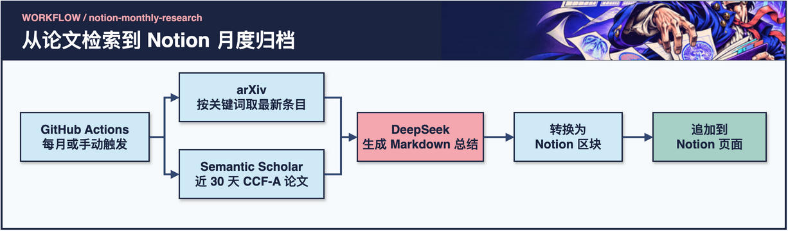

# notion-monthly-research

**把关注的研究主题，变成 Notion 里可回溯来源的论文清单。**


为用 Notion 整理论文的研究者准备的个人工具：按关键词追踪近期 arXiv 论文与指定会场记录，生成中文样本观察，并把论文标题、日期、命中关键词和来源链接一起归档。每月自动运行，也可以手动触发。

[真实检索节选](examples/source-preview.md) · [首次运行](#首次运行) · [不接模型先试检索](#本地运行与预览) · [故障排查](#故障排查) · [使用与授权](#使用与授权)

## 它能帮你做什么

- **省去重复整理**：定期抓取、筛选和追加到自己授权的 Notion 页面。
- **保留核验入口**：可点击的论文标题、日期和摘要摘录随报告保留，不只留一段模型总结。
- **自行选择服务商**：默认 DeepSeek，可选 OrcaRouter；密钥由你自己配置。
- **先预览再写入**：可只检索，或生成本地 Markdown；首次 Actions 试跑可创建独立子页面。

适合已有研究主题、愿意配置 GitHub Actions 和 Notion 集成的用户。当前是可自行部署的研究工具，不是托管订阅服务，也不是完整的系统性综述检索平台。

## 首次运行

需要 GitHub 账号、可授权的 Notion 页面，以及所选服务商的 API 密钥。先阅读[使用与授权](#使用与授权)。

1. Fork 仓库，进入 **Actions**，启用工作流。
2. 在 [Notion My Integrations](https://www.notion.com/my-integrations) 创建集成，保存 token；在目标页面的 **··· → 添加连接** 中授权该集成。复制页面 ID（URL 中的 32 位 ID，不是整个 URL）。
3. 在仓库 **Settings → Secrets and variables → Actions → Secrets** 中添加以下三项：

| Secret | 默认 DeepSeek | 使用 OrcaRouter |
| --- | --- | --- |
| 模型密钥 | `DEEPSEEK_API_KEY` | `ORCAROUTER_API_KEY` |
| Notion 集成 token | `NOTION_TOKEN` | `NOTION_TOKEN` |
| 目标页面 ID | `NOTION_PAGE_ID` | `NOTION_PAGE_ID` |

4. 在同页的 **Variables** 中设置 `QUERY_KEYWORDS`，例如 `multimodal alignment, contrastive learning`。若使用 OrcaRouter，再设置 `LLM_PROVIDER=orcarouter`；不设置则使用 DeepSeek。
5. 进入 **Actions → Monthly Notion Summary → Run workflow**。第一次建议勾选 `test_page`，把报告写到目标页下新建的独立子页面。`provider=configured` 使用仓库配置，也可单次指定服务商。
6. 等待任务完成，在 Notion 检查“样本观察”、两组论文与数据源状态。测试模式会进一步核验报告章节和可点击的论文标题。之后不勾选 `test_page`，就会追加到目标页。

每月 1 日 **UTC 00:00 / 北京时间 08:00** 自动执行。重复运行会再次追加，暂不自动覆盖或跨次去重。若写入中途失败，应先检查已有区块再决定是否重跑。

## 可选服务商与费用

默认配置直连 [DeepSeek](https://platform.deepseek.com/)，使用 `deepseek-reasoner`。使用 OrcaRouter 时，当前预设模型为 `deepseek/deepseek-v4-flash-free`，端点为 `https://api.orcarouter.ai/v1`。模型可用性、额度和价格以服务商当前页面为准，不承诺永久免费。

已有 OrcaRouter 账号可直接使用自己的密钥；新用户可以通过[项目推荐链接](https://www.orcarouter.ai/ref/ref_cb687af623af382d6377)注册。**利益披露：符合平台归因与结算规则的付费消费，可能为维护者带来分成。** 使用推荐链接不是运行工具的前提，选择其他服务商也不影响工具功能。

模型调用、GitHub Actions 和其他服务可能产生各自费用，请查看自己账号的额度。代码不会替你充值，也不会自动购买套餐。

## 配置参考

| 配置 | 放置位置 | 作用 |
| --- | --- | --- |
| `LLM_PROVIDER` | Actions Variable | `deepseek`（默认）或 `orcarouter` |
| `QUERY_KEYWORDS` | Actions Variable | 逗号分隔的主题短语；也兼容旧版同名 Secret，Variable 优先 |
| `CCF_A_VENUES` | Actions Variable | 可选的逗号分隔会场列表；不设置时使用脚本默认列表 |
| `SEMANTIC_SCHOLAR_API_KEY` | Actions Secret | 可选，供 Semantic Scholar 请求使用 |

关键词按“任一完整短语命中”处理，检查标题和摘要，忽略大小写和连字符差异。例如 `CT` 不会误匹配 `activity`，但较宽的主题仍可能带来你不需要的论文。同义词和缩写应自行补充；它不是语义检索。

`CCF_A_VENUES` 是历史配置名称。实际会场以配置列表和 Semantic Scholar 索引为准，程序不负责认证当前 CCF 等级或穷尽全部会场。

## 本地运行与预览

需要 Python 3.10+。在仓库目录创建独立环境：

```bash
python3 -m venv .venv
source .venv/bin/activate
python -m pip install -r requirements.txt
```

**只检索公开论文，不需要模型或 Notion 密钥：**

```bash
QUERY_KEYWORDS="multimodal alignment" python push_summary.py --fetch-only --output papers.md
```

**生成本地报告，不写入 Notion：** 先通过环境变量安全提供 `OPENAI_API_KEY`，再运行：

```bash
python push_summary.py --dry-run --output report.md
```

**写入 Notion：** 另外提供 `NOTION_TOKEN` 和 `PAGE_ID`，然后运行：

```bash
python push_summary.py
```

本地可设置 `OPENAI_BASE_URL` 和 `OPENAI_MODEL`。使用 OrcaRouter 时分别设为 `https://api.orcarouter.ai/v1`、`deepseek/deepseek-v4-flash-free`，并用 `OPENAI_API_KEY` 提供 OrcaRouter 密钥。

脚本不会自动加载 `.env`。请通过当前进程环境或你自己的密钥管理方式注入；不要把真实密钥写进脚本、公开 issue 或截图。`--dry-run` 仍会调用模型，可能产生费用；只有 `--fetch-only` 不调用模型。

## 数据流与已知边界

[](assets/readme/workflow-zh.webp)

[可编辑流程图](assets/readme/workflow-zh.drawio) · [Actions 工作流](.github/workflows/main.yml) · [摘要脚本](push_summary.py)

| 阶段 | 实际行为 |
| --- | --- |
| arXiv | 查询近 30 天候选并本地核验主题、日期和重复项，最多保留 12 条；API 暂不可用时尝试一次公开搜索页，从前 50 条候选筛选并标注覆盖限制 |
| Semantic Scholar | 一次 bulk 请求限定主题、会场和日期；每会场最多 3 条，总计最多 12 条，不遍历后续分页 |
| 模型 | 根据标题与摘要摘录生成 2–4 条中文样本观察；程序独立附加论文条目和数据源状态 |
| Notion | 按标题、段落和列表生成区块，保留论文链接，按批次追加 |

检索不是全文核验，摘要摘录每篇最多 1500 字符。模型生成内容可能出错，引用研究结论前仍需阅读原论文。两组来源都没有有效论文记录时，会停止生成，不让模型补造论文；单一来源不可用时保留明确提示。

模型服务商会收到你的检索主题和筛选后的标题、摘要摘录。脚本不会读取已有 Notion 页面正文用于生成；报告写到你授权的目标页。代码没有添加维护者自己的用户追踪服务，第三方平台各自的数据处理规则仍然适用。

## 故障排查

| 现象 | 处理方式 |
| --- | --- |
| `Missing required configuration` | 检查服务商对应的模型 Secret、`NOTION_TOKEN` 和 `NOTION_PAGE_ID`；不要把 Secret 放成 Variable |
| Notion 401 / 403 / 404 | 核对 token、页面 ID，以及集成是否连接到该页面 |
| 模型鉴权、额度或模型不存在 | 查看当前服务商的密钥、账户额度与模型目录；不要把不同平台的密钥混用 |
| 检索被限流 / 会场结果为空 | 查看数据源提示；可以稍后再试或调整关键词。空结果不证明没有相关论文 |
| `No paper records retrieved` | 所有来源都没取得有效记录；本次未调用模型生成报告 |
| 页面已写入一部分，但任务失败 | 先检查现有内容，避免直接重跑造成重复；Notion 的不明确写入失败不会被盲目重试 |
| Fork 后定时任务没运行 | 确认启用了 Actions，先手动运行一次；再查看 GitHub 对定时工作流的当前限制 |

## 反馈与使用授权

发现问题可提交 [Issue](https://github.com/Xiaoqian-Zhang-Shawno/notion-monthly-research/issues)，描述运行方式、错误类型、期望与实际行为。分享日志前请删去密钥、Notion 页面 ID、私人研究主题和个人信息。

<a id="使用与授权"></a>
本项目为个人维护的公开源码工具，当前未采用 MIT 或其他标准开源许可证。具体权利边界见 [COPYRIGHT.md](COPYRIGHT.md)；商业集成、转售、托管或白标用途请先核实授权。正式的使用许可仍在整理，本说明不撤销已有合法权利，也不替代第三方组件自身的许可。

<details>
<summary>早期更新日志</summary>

2025.06.06：首次成功将摘要写入 Notion。

2025.09.22：切换模型接口，支持 OpenAI-compatible 配置。

2026.11：新增可选 OrcaRouter、主题与日期核验、独立测试页、检索预览及来源状态提示。

</details>
