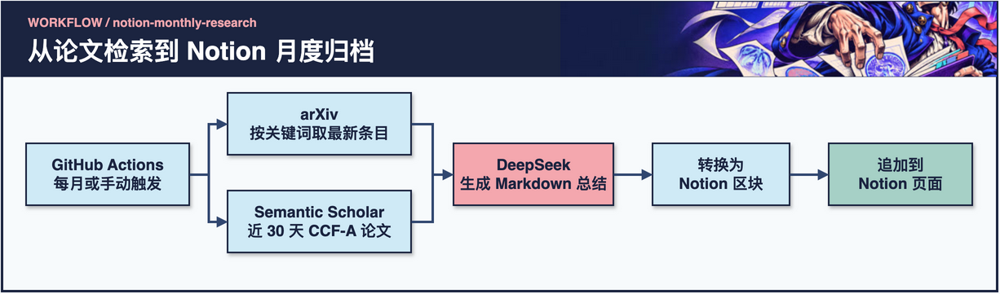

# notion-monthly-research


**定期检索论文，将研究趋势与来源条目归档到 Notion。**

GitHub Actions 每月 1 日运行，也支持手动触发。脚本按关键词检索 arXiv，通过 Semantic Scholar 获取指定 CCF-A 会场的近期条目，再由 DeepSeek 根据论文列表生成 Markdown 趋势摘要。

[首次运行](#首次运行) · [工作流程](#工作流程) · [配置参考](#配置参考) · [本地运行](#本地运行) · [故障排查](#故障排查)

## 工作流程

[](assets/readme/workflow-zh.webp)

[可编辑源图（draw.io）](assets/readme/workflow-zh.drawio) · [Actions 工作流](.github/workflows/main.yml) · [摘要脚本](push_summary.py)

| 阶段 | 输入 | 产物 |
| --- | --- | --- |
| 触发 | 每月 1 日 UTC 00:00 或手动运行 | GitHub Actions 作业 |
| arXiv | 逗号分隔的主题关键词 | 按提交时间倒序取最多 12 条匹配条目 |
| Semantic Scholar | CCF-A 会场列表 | 每个会场查询最多 3 条，再按近 30 天的发布日期筛选，合计最多 12 条 |
| DeepSeek | 两组论文列表 | Markdown 趋势摘要与论文条目 |
| Notion | 转换后的标题、段落和列表区块 | 追加到已授权的目标页面 |

## 首次运行

1. Fork 仓库，进入 **Actions**，启用工作流。
2. 在 [DeepSeek 控制台](https://platform.deepseek.com/) 创建 API 密钥。在 [Notion My Integrations](https://www.notion.com/my-integrations) 创建集成，保存集成 token。
3. 在目标 Notion 页面打开 **··· → 添加连接**，授权该集成，并复制页面 ID。首次调试可以使用单独的测试页。
4. 在 GitHub 仓库的 **Settings → Secrets and variables → Actions** 添加下表所需的 Secrets。
5. 从 **Actions → Monthly Notion Summary → Run workflow** 手动运行一次。在运行日志中检查 DeepSeek 与 Notion 步骤，再打开目标页查看新增标题、摘要与两组论文列表。

> [!IMPORTANT]
> Actions 会向目标页追加一条 smoke test，再运行正式摘要脚本。手动重跑会再次追加内容，现有工作流按追加模式运行。

## 配置参考

| GitHub Secret | 脚本读取的变量 | 用途 |
| --- | --- | --- |
| `DEEPSEEK_API_KEY` | `OPENAI_API_KEY` | 调用 DeepSeek 的密钥 |
| `NOTION_TOKEN` | `NOTION_TOKEN` | 已授权目标页面的集成 token |
| `NOTION_PAGE_ID` | `PAGE_ID` | 摘要追加到的页面 |
| `QUERY_KEYWORDS`（可选） | `QUERY_KEYWORDS` | 例如 `medical imaging, segmentation, ultrasound, CT` |

Actions 的端点由工作流中的 `OPENAI_BASE_URL` 指定，摘要脚本请求 `deepseek-reasoner`，Actions 烟测请求 `deepseek-chat`。若更换供应商，需要一并确认两个请求使用的模型 ID 和端点。

本地运行还可设置逗号分隔的 `CCF_A_VENUES`。当前 Actions 配置使用脚本内置的会场列表。arXiv 使用关键词，Semantic Scholar 使用会场查询与日期过滤。

## 本地运行

需要 Python 3.10+。在仓库根目录使用独立环境安装依赖。

```bash
python3 -m venv .venv
source .venv/bin/activate
python -m pip install "openai>=1.0.0" requests feedparser
```

在当前 shell 中设置 `OPENAI_API_KEY`、`NOTION_TOKEN` 和 `PAGE_ID`。按需设置 `OPENAI_BASE_URL` 与 `QUERY_KEYWORDS`。运行与 Actions 相同的摘要脚本。

```bash
python -u push_summary.py
```

> [!NOTE]
> 本地运行会实际请求论文源和模型，并写入 Notion。模型收到的是检索到的论文条目。密钥应通过环境变量或 Actions Secrets 注入。

## 故障排查

| 现象 | 优先检查 |
| --- | --- |
| Actions 没有运行 | 检查仓库是否启用 Actions，手动触发一次以定位配置问题。 |
| 模型鉴权或模型 ID 报错 | 检查 `DEEPSEEK_API_KEY`、端点，以及烟测与正式摘要各自使用的模型。 |
| Notion 返回权限或找不到页面错误 | 检查集成是否已添加为目标页面的连接，以及页面 ID 是否正确。 |
| CCF-A 列表为空 | 查看是否有会场请求失败，再确认日期窗口内是否有返回条目。 |
| 页面只出现 smoke test | 检查正式摘要步骤的日志，确认检索、模型请求及最终追加执行到了哪一步。 |

**如何使用摘要。** 这份报告适合筛选值得读的论文。检索覆盖受关键词、会场、返回上限和日期过滤影响，趋势概括应回到原论文复核后再引用。

## Notion 中会看到什么

每次正式运行会追加一个以运行月份为标题的摘要区块组。下面是版式示意。

```text
YYYY 年 MM 月 · 多模态研究热点论文总结
  趋势概览
  arXiv 论文列表
  CCF-A 最新论文
```

脚本将 Markdown 标题、列表和普通段落映射为相应的 Notion 区块。arXiv 条目以提交时间排序，可能早于 30 天。CCF-A 列表则在查询结果上应用 30 天日期筛选。读到值得跟进的条目时，使用附带的来源链接打开论文，核对摘要引用的趋势和证据。

## 仓库入口

- [定时与手动触发配置](.github/workflows/main.yml) 包含依赖安装、服务烟测与脚本入口。
- [push_summary.py](push_summary.py) 包含论文源查询、模型提示、区块转换和 Notion 写入逻辑。
- [可编辑流程图](assets/readme/workflow-zh.drawio) 记录上述组件和数据流。

<details>
<summary>早期更新日志</summary>

2025.06.06<br>
_notion上成功更新了，这是伟大的开始_<br>
我尝试接入gpt，更多期刊尝试更新抓取中，可以给我更多的推荐！！！<br>
2025.09.22<br>
md,gpt太贵了我更新了接口，可以使用所有大模型，我现在换成了deepseek<br>

</details>
